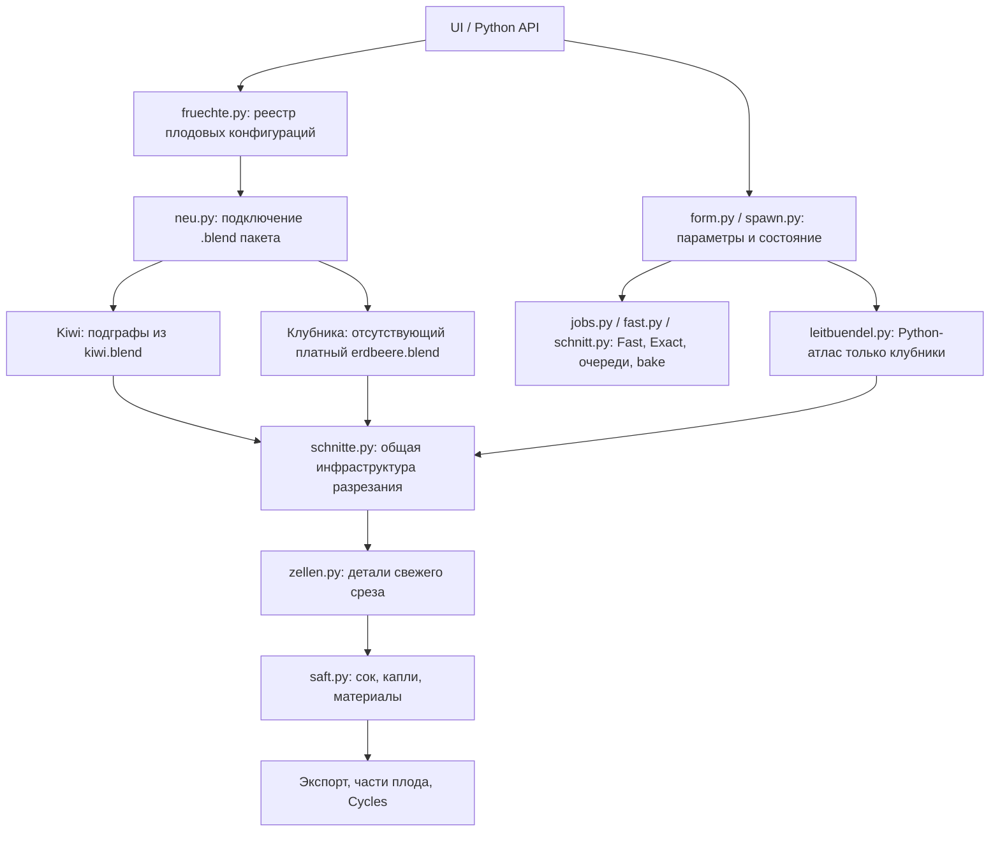
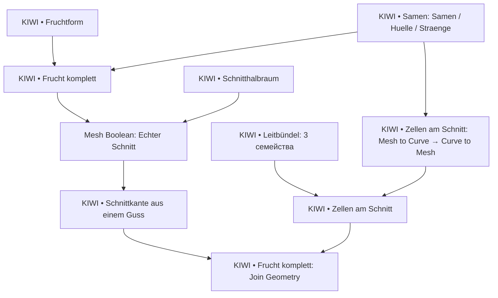
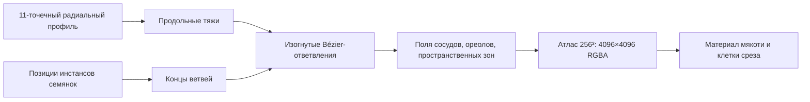

# Frucht Free 0.4.3 — полный технический аудит архитектуры Kiwi и клубники

**Дата проверки:** 21 ноября 2026 · **Проверенная среда:** Blender 5.2.4 LTS · **Основание:** именно переданный пользователем `frucht-free-kiwi-0.4.3.zip`, SHA-256 `aaa218470ab068ed1cb806308d9a4da1d43fd5d9e3de30f6486ac7d204787877`.

**Объём фактической проверки:** 46 Python-модулей (19 837 строк), 71 объект ZIP, работающий для чтения `daten/kiwi.blend` с **22 Geometry/Shader нодовыми группами**, 11 объектами и 11 материалами; `daten/zellen_saft.json` со снимками части клубничных графов. Проверены исходники и связи GN. Проверки финальной коммерческой Strawberry-сцены **не было**: `erdbeere.blend` отсутствует. Исходные бинарники, видео и нодовые графы правообладателя в публичный GitHub **не переносим**.

## Результат в одном абзаце

Общая **архитектура приложения** у Kiwi и клубники — данные плода → форма/семена/внутренние структуры → режущая геометрия → поверхность среза/материалы → экспорт и управление. Но у **конкретных проводящих структур различная реализация**. У Kiwi полная цепь представлена в `kiwi.blend`: группа `KIWI • Samen` строит семена и `Samenstrang`, группа `KIWI • Leitbündel` — три семейства сосудов, а `KIWI • Zellen am Schnitt` собирает их с геометрией клеток и соком. Для клубники пространственные кривые и их растровый атлас готовятся Python-модулем `leitbuendel.py` из позиций **реальных GN-инстансов семянок**, после чего отдельные фрагменты GN, восстановленные из `zellen_saft.json`, детализируют срез и добавляют сок. Источник подтверждает сам механизм; полное окончательное соединение коммерческих нодов остаётся непроверенным.

## 1. Что есть в бесплатной поставке и чего нет

| Проверено в ZIP | Практический смысл | Точное основание |
|---|---|---|
| `edition.FRUECHTE = ('KIWI',)` | В Free реально доступен Kiwi; список других фруктов в Python не означает доступа к ним | `edition.py:1–2`; `neu.py:13–20,210–226` |
| `daten/kiwi.blend` | Доступен полноценный граф Kiwi: 22 группы, включая фрукт, семена, клетки, сосуды, срез | фактически открыто в Blender; `kiwi-inspection.json` (приватное приложение) |
| `fruechte.ERDBEERE`, `leitbuendel.py`, `formen.py`, `zellen.py`, `saft.py` | В бесплатном расширении осталась весьма подробная реализация **части клубничного механизма** | `fruechte.py:13–88`, `leitbuendel.py`, `zellen.py`, `saft.py` |
| `daten/zellen_saft.json` | Содержит **частичные описания нодовых графов** из более полной Strawberry-сцены; функции умеют восстанавливать соответствующие части | `nachbau.py:10–73`; `zellen.py:73–201`; `saft.py:24–160` |
| Нет `daten/erdbeere.blend` | Нет полного исходного материала коммерческой клубники — её кожи, базовых GN-нодов, связанных материалов и сценовых объектов | фактический список 71 объекта ZIP; `fruechte.py:24–25`; `neu.py:224–226` |
| `formbeere.py` — заглушка | Не все механизмы формы в бесплатной редакции доступны в рабочем виде | `formbeere.py:1–12` |

Манифест прямо заявляет `Frucht Free - Kiwi`, Blender >=5.2.0, лицензию **GPL-3.0-or-later** (`blender_manifest.toml`). Исходный архив хранится отдельно; этот отчёт не является перепубликацией кода автора.

## 2. Два уровня общности: инфраструктура vs анатомический генератор

**Общая инфраструктура:** `fruechte.py` меняет активный набор имен объектов, групп и параметры `fast`, `schnitte`, `spawn`, `teile` (`fruechte.py:328–365`). `neu.py` подгружает плод из соответствующего `.blend`, подключает UI, а `fast.py`, `schnitte.py`, `jobs.py`, `teile.py`, `spawn.py` обеспечивают управление ножом, разрезами, запеканием, состояниями и частями. `schnitt.py:8–60` различает режимы `PLATZ` / `FAST` / `GENAU` (не один единственный live-алгоритм). `automatik.py` и `form.py:861–955` управляют пересчётом и задержкой обновления.

**Различие конкретной геометрии:** Kiwi использует собственные подграфы и собственные поля `KIWI • ...`, а клубника имеет Strawberry-специфические Python-функции и кадры GN из другого шаблона. Сходство подходов **не означает идентичные ноды или одинаковые формулы**.

## 3. Kiwi: фактический граф из `kiwi.blend`

Проверено через API `bpy.data.node_groups` при открытии исходного `daten/kiwi.blend` в Blender 5.2.4. Важно: это **реальные данные пакета**, не догадка по видео.

| Нодовая группа | Узлов / связей | Подтверждённая функция |
|---|---:|---|
| `KIWI • Frucht komplett` | 38 / 68 | Основная сборка: оболочка, семена, нож, клетки, кожура, волосы, чашелистики |
| `KIWI • Fruchtform` | 90 / 125 | Параметрическая форма фрукта |
| `KIWI • Samen` | 257 / 347 | Генерация семян (`Samen`), оболочек (`Huelle`) и геометрии семенных тяжей (`Straenge`) |
| `KIWI • Leitbündel` | 408 / 555 | **Три** пространственных системы: `Fruchtwand-Bündel`, `Seitenäste`, `Septum-Bündel` |
| `KIWI • Zellen am Schnitt` | 244 / 371 | Клетки и подложка среза, объёмные поля, сосуды, семенные тяжи, капли |
| `KIWI • Gewebe` | 301 / 412 | Математические поля тканей; есть отдельная shader-версия той же группы |
| `KIWI • Zelltypen` | 154 / 223 | Варианты клеток, неровности, 3D-шум/Voronoi; отдельная shader-версия |
| `KIWI • Schnitthalbraum` | 39 / 56 | Геометрия режущего полупространства |
| `KIWI • Schnittkante aus einem Guss` | 16 / 18 | Постобработка кромки разреза |
| `KIWI • Zellfarbe` | 57 / 89 | Поля окраски клеток; отдельная shader-версия |
| `KIWI • Lage` | 232 / 335 | Общие пространственные координаты/зоны; отдельная shader-версия |

**Фактическая трассировка по связям GN:**

В `KIWI • Zellen am Schnitt` действительно присутствуют **3 Mesh Grid**, **5 Volume Cube**, **4 Store Named Grid**, отделение наружных/внутренних участков, отдельные материалы, несколько слоёв ткани и генерируемые капли. `KIWI • Samen` выдаёт сетку `Straenge`; `Mesh to Curve` в клеточной группе принимает именно её и после `Curve to Mesh` обрезает с удалённой стороны среза. Параллельно `KIWI • Leitbündel` передаёт собственную геометрию (`Leitungen`) в тот же `Join Geometry`. **Следовательно, у Kiwi тоже есть связь с семенами**, но не та же организация, что у клубники.

Параметры `Vessel Width` / `Vessel Count` (`fruechte.py:90–103`) обрабатываются через `_kiwi_leit()` (`form.py:448–458`): настраиваются как минимум `Fruchtwand-Bündel` (опорное 18) и `Septum-Bündel` (опорное 72). Третье семейство `Seitenäste` существует в реальном GN, но этот конкретный Python-хелпер явно регулирует только два названных семейства. Нельзя приписать ему неподтверждённое UI-поведение.

## 4. Клубника: точно прослеживаемая цепочка, без закрытого .blend

### 4.1. Поверхностная геометрия и семянки

- `fruechte.py:13–88`: словарь формы, экстраслайдеры, их диапазоны и классы перестроения (`shader`, `vorrat`, `innen`, `innenform`, `anzeige`).
- `formen.py`: аналитические деформации ягодной формы, включая `_kerbe`, `_furchen`, обратное преобразование координат для поля ткани. `form.py:461–529` подключает пересчёт формы через Geometry Nodes.
- `form.py:164–223`: перераспределение семянок и расчёт точек на поверхности с использованием равномерного по площади параметра профиля и золотого угла; фактическая платная сцена связывает эти источники со своей GN-системой. Отдельные параметры глубины/ширины/шума углублений задаются в `form.py:69–123`.

### 4.2. Сосудистая система — математическая основа

`leitbuendel.py:9–15,19–81` содержит полный доступный алгоритм пространственной сети:

1. **Профиль осевой системы:** 11 табличных точек `PROFIL` по Z (примерно от −1.49 до +1.10), интерполяция **монотонной кубической Hermite/PCHIP** (`radius`, строки 19–40). Радиус меняется **существенно**: около 0.014 внизу, до ~0.380 в средней части, затем уменьшается. Это фундаментально отличается от нашего почти равномерного цилиндра v2.
2. **Нецентрированная ось:** `achse(z)` со сдвигом в X/Y, а `ring_radius(z, theta)` добавляет азимутальную неравномерность (`43–53`). Продольные тяжи следуют этим кольцам, а не прямым вертикальным линиям.
3. **Начальные несущие тяжи:** по умолчанию `Vessel Strands=28`; для каждого строится пространственная линия, 380 точек, переменная толщина (`56–64`). Это **28 главных носителей**, а не 28 всех волокон.
4. **Концы ветвей:** `_enden()` берёт **GN-instance_transform из `INNEN | vollständige Achänen`**, немного смещает внутрь (`301–336`). Таким образом, геометрические положения семянок — источник адресов ветвей, а не просто маркеры для визуализации.
5. **Одна ветвь к каждому концу:** `fasern(enden,w)` выбирает центральный тяж по направлению точки, поднимает начало по Z, создаёт **кубическую кривую Безье с двумя управляющими точками** и индивидуальным прогибом (`65–80`). Радиус ветви уменьшается по длине.
6. **Объёмный атлас:** `rechnen()` (`120–144`) отдельно растеризует ядра сосудов и расширенную область вокруг них. Два поля «сосуд/ореол» и профиль относительного расстояния к кольцевой системе записываются в три цветовых канала 3D-атласа 256³, упакованного в квадрат **4096 × 4096** как 16×16 срезов. Альфа фиксируется равной 1.

**Схема с функциональной зависимостью:**

**Обновление атласа:** `leitbuendel.py:157–189,339–420` составляет ключ из параметров `leit_*`, проверяет устаревание, считает NumPy-атлас в отдельном потоке, возвращается через Blender timer, сохраняет результат как упакованный EXR и сообщает об изменении шейдерам. Вызывается через очереди `jobs.py:239–241,441–447`, `form.py:937–941`, `schnitt.py:43–46`. Это **пересчёт с кэш-ключом**, но не доказательство полного кэша всей геометрии SourceVolume или плавного интерактивного ножа.

### 4.3. Полость: отдельная полноценная геометрия, не шарик

`leitbuendel.py:200–298` строит неправильную вытянутую полость: **191 кольцо × 96 секторов**, зависимость ширины от осевого профиля, несколько частот шума, смещение оси, сглаживание и **32 отдельных тканевых мостика** (`INNEN | Gewebebrücken im Lumen`). Это полноценные меши (`INNEN | echte unregelmäßige Markhöhlung` и мостики). Ползунок `Cavity` приводит к геометрическому перестроению, а не к перекрашиванию поверхности. Утверждение о видимости данной полости при **любом** положении коммерческого ножа потребовало бы самого платного `.blend`.

### 4.4. Разрез → реальная клеточная геометрия → сок

Три слоя разнесены между модулями:

1. **Разрезание и классификация материалов.** `schnitte.py:985–1128`: `Mesh to SDF Grid` на внешней и полой частях, `SDF Grid Boolean` для вычитания полости, сохранение именованной сетки `form`; затем отдельный нож, `DIFFERENCE` и `Grid to Mesh`. Классификация по расстоянию до внешней поверхности, стенок и ножа; атрибуты `schnitt_rand_abstand`, `ist_wand` помогают отличать свежий срез, кожуру и внутреннюю стенку.
2. **Геометрия клеток на срезе.** `zellen.py:73–201`: выбирается материал свежего среза → `Separate Geometry` с доменом FACE → **Subdivide Mesh только выделенных граней** → настоящее `Set Position`, фактура из 3D/рест-координат и атласа → `Join Geometry` с нетронутой остальной геометрией. Граничные вершины отфильтровываются/защищаются дополнительной логикой. Регуляторы: `Cell Size`, `Height`, `Strand Relief`, `Edge Fade`, `Detail`. **Это тот этап, который мы в M1e6 пытались заменить фаской.** Существование кода не доказывает, что каждая возможная топология после всех таких операций останется watertight: платного файла для теста нет.
3. **Сок и капли.** `saft.py:80–160`: отдельный процедурный слой точек/капель через группы из сохранённого JSON; параметры `Amount`, `Drop Size`, `Thickness`, `Fine Drops`, `Keep Off Edge`, `Seed`. `saft.py:255–268` ставит модификатор на конец стека после клеток; с настоящими клетками обычно не добавляет ещё одно полное подразделение. Шейдер `SAFT • Wasser` и материал `FRUCHT | Saft` восстанавливаются через `nachbau.py`.

**Важная граница:** `zellen.py` и `saft.py` присутствуют в Free и их код читается, но полноценная Strawberry-ветка, в которую они должны встраиваться, в архив не включена. Не выдаём это за полностью выполненный тест коммерческого конвейера.

## 5. Частичные схемы в `daten/zellen_saft.json`

Внутри указан источник с названием `Erdbeere_Biss_4Bisse_Werbung.blend` (дата проекта 8.11.2026, экспорт описан как 12.11.2026) — **это строка происхождения в JSON, не сам `.blend`**.

| Сохранённая часть | Узлов | Связей | Значение |
|---|---:|---:|---|
| `zellen` | 97 | 115 | Фрагмент обработки геометрии среза; в метаданных исходная группа имеет 447 узлов |
| `saft` | 87 | 114 | GN-геометрия капель и влажных участков |
| `saft_material` | 2 | 1 | Внешний материал капель |
| `saft_wasser` | 12 | 14 | Подгруппа шейдера воды/сока |
| `fleisch_werte` | 17 настроек | — | Сохранённые значения именованных узлов мякоти: зоны, цвет, зернистость, клеточные стенки и т.п. |

`nachbau.py:10–73` читает описания узлов и связей и восстанавливает соответствующие фрагменты; `zellen.py` и `saft.py` затем меняют разметку, связи и параметры. **Фрагменты не эквивалентны полному 447-узловому графу**, не содержат всего оплачиваемого `.blend` и не доказывают полную реконструкцию коммерческого результата.

## 6. Карта регуляторов: что пересчитывается

| Контроллер | Где объявлен / реализован | Что следует из кода | Степень уверенности |
|---|---|---|---|
| `Vessel Strands` (28, 6–48) | `fruechte.py:69`; `leitbuendel.py:59–64` | Количество центральных продольных несущих тяжей, требует перестройки пространственной сети/атласа | Подтверждено |
| `Fiber Width` (1, 0.3–2.5) | `fruechte.py:71`; `leitbuendel.py:80` | Толщина ветвей к семянкам | Подтверждено |
| `Strand Width` (1, 0.3–2.5) | `fruechte.py:70`; `leitbuendel.py:64` | Толщина несущих тяжей | Подтверждено |
| `Fiber Sag` (1, 0–2) | `fruechte.py:72`; `leitbuendel.py:75–79` | Контрольные точки и прогиб Bézier-ветви | Подтверждено |
| `Halo Width` (1, 0.3–2.5) | `fruechte.py:73`; `leitbuendel.py:125–129` | Область вокруг сосудов в атласе | Подтверждено |
| `Fiber Pattern` (0, 0–99) | `fruechte.py:74`; `leitbuendel.py:56–57` | Seed стохастики в геометрическом генераторе | Подтверждено |
| `Vessel Strength` (1, 0–2) | `fruechte.py:65`; `form.py:844–850` | Класс `shader`; интенсивность сосудистого рисунка без обязательной перестройки сети | Подтверждено как класс; финальное графовое подключение не проверено |
| `Cavity` (1, 0.2–2) | `fruechte.py:75`; `leitbuendel.py:168–184,200–298` | Размер/перестройка неровной полости и мостиков | Подтверждено |
| `Cell Size / Height / Strand Relief` | `zellen.py:11–17,164–182` | Настоящее подразделение/смещение на свежих гранях | Подтверждено для доступного генератора |
| `Amount / Drop Size / Thickness` | `saft.py:13–20,102–131` | Геометрия капель, не только изменение цвета | Подтверждено для доступного генератора |
| `Vessel Count / Width` у Kiwi | `fruechte.py:90–102`, `form.py:448–458` | Меняет параметры некоторых GN-семейств Kiwi | Подтверждено |
| `Core Fibers` на видео (~00:16–00:17) | Только проморолик | Не доказано, что это синоним `Vessel Strands`, `Vessel Strength` или другого параметра | **Не установлено** |

## 7. Практический вывод: где у нас был неправильный порядок

| Наш проект | Что уже было в доступном архиве | Вывод |
|---|---|---|
| M1a: 539 кривых к семянкам | `leitbuendel.py::_enden()` + `fasern()` | У нас правильно обнаружилась топологическая связь, но потом её потеряли в новых прототипах |
| Volume First v1: 494 свободно заканчивающиеся линии | Конечные точки должны исходить из GN-позиций семянок | Нельзя улучшать реализм, только увеличивая количество случайных нитей |
| Volume First v2: 539 концов, но радиальные «спицы» | 11-точечный PCHIP профиль + нецентрированная ось + две управляющие точки Безье | Исправлены назначения, **не восстановлена пространственная морфология** |
| M1e2–M1e6: сложности с динамическими срезами, global subdiv/bevel | `zellen.py` — FACE separation, локальное подразделение, защита краёв, объединение | Требовалось сначала разобрать уже доступный механический образец |
| Искусственная круглая полость | `hoehle_bauen()` — вытянутая неправильная форма, 32 мостика | Большая сферическая дырка была неверным визуальным допущением |
| Дорогие SDF и попытка всё считать live | Атлас считается и кэшируется отдельно; разрез и клеточная геометрия имеют отдельные стадии | У Frucht уже явно разведены source field, срез и последующий look-dev |

## 8. Строгие границы доказанного

**Надёжно:** код конкретных формул и параметров клубники; факт 539 связей в *нашем* M1a (это число не универсальная константа Frucht); наличие семенных тяжей и трёх систем сосудов у Kiwi; количественный состав настоящего Kiwi GN; частичные клубничные GN-описания; три режима разрезания в общей инфраструктуре.

**Нельзя утверждать:** что пропущенная коммерческая сцена содержит эти модули в неизменном виде; что все её шейдеры можно восстановить из JSON; что `Core Fibers` на видео привязан к конкретному API-полю; что у Frucht количество семянок равно нашему 539; что выставленные значения на видео соответствуют точным Python-диапазонам без проверки wiring; что у Kiwi и клубники используется идентичный код или ботаническая модель.

## 9. Предлагаемый минимальный инженерный эксперимент

Вместо очередной сборки Strawberry Lab **сначала проверить правильную морфологию на уровне сосудистой сети**:

1. Сохранить 539 *наших* истинных связей «ветвь → семянка» без перепроекции, когда возможно, на одной согласованной поверхности.
2. Реализовать **независимо** математическую модель с явной высотной функцией радиуса, нецентрированной осью и управляемыми Bézier-пучками. Сравнить 14/28/40 несущих тяжей и несколько значений прогиба при неизменных концах.
3. Сделать **одну и ту же камеру и освещение** для настоящих Blender Fiber-only, semi-transparent и full cut; исходный кадр автора использовать только в приватном сравнении.
4. Проверить отдельный cut-surface алгоритм на двух направлениях, сначала с локальной FACE-детализацией и сохранением швов, затем тканевыми полями/атласом и влажной фактурой.
5. Вернуться к анимации ножа **только после** визуального выигрыша и геометрических тестов. Измерить bottleneck и не считать 256³ атлас обещанием FPS.

**Исходные материалы:** `frucht-free-kiwi-0.4.3.zip` и его `daten/kiwi.blend`; `kiwi-inspection.json`, `inventory.json` хранятся только в закрытом рабочем архиве аудита. Этот Markdown — наша самостоятельная исследовательская интерпретация, без исходных нодов или фрагментов чужого кода.
